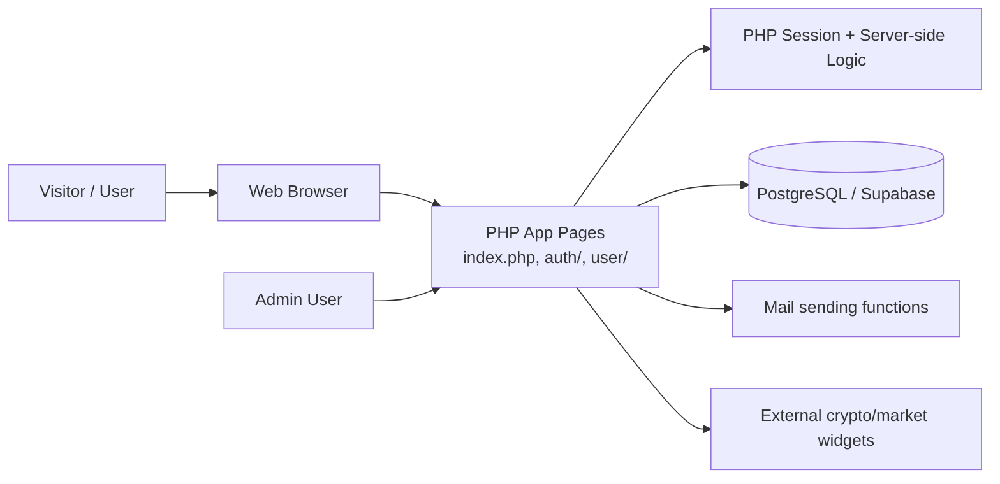

# Ruxfund

Ruxfund is a PHP-based crypto investment / fundraising-style web application. It provides a public marketing site, user registration and authentication, investment plan selection, referral tracking, wallet configuration, transaction summaries, and administrative controls.

This repository is best described as an MVP-style financial web application and a portfolio project. It demonstrates server-side PHP, relational database modeling, and a classic multi-page web app architecture. It is not presented here as a production-ready financial platform.

## Project status

Status: MVP / prototype / functional demo

This repository contains a working application structure and a database schema for a crypto-investment platform, but it still has important limitations:

- There is no verified public deployment URL in the repository.
- No automated test suite is present.
- The project currently relies on a legacy PHP architecture and custom database helpers rather than a modern framework.
- Security hardening should be completed before any real production deployment or public launch.

## Live demo

No verified live application URL was found in the repository or project metadata. Please run the app locally using the instructions below.

## Engineering highlights

- Server-side PHP business logic for auth, account management, deposits, withdrawals, and referral tracking
- PostgreSQL/Supabase schema designed for the app’s data model
- Investment-plan logic driven from database configuration instead of hard-coded values
- Referral-driven account acquisition and incentive model
- Session-based user flow and admin configuration patterns
- Deployment configuration for PHP hosting and Wasmer

## Features

### Implemented

- Public marketing landing page with investment messaging and pricing blocks
- User registration and login
- Referral and affiliate tracking
- Investment plan listing and account funding flow
- Withdrawal and transfer-related transaction handling
- Wallet address management
- KYC submission workflow
- FAQ/testimonial content management
- Admin dashboard and admin login flow
- PostgreSQL/Supabase schema and migration guidance
- Public and account-level investment plan navigation backed by the `plan` table
- Deposit selection and payment-instruction flow backed by configured `sitewallet` records

### Partially implemented or unclear

- Real crypto payment processing and bank/crypto settlement flows are not fully documented or proven in the codebase.
- Some transaction flows are modeled, but direct external blockchain or payment infrastructure integration appears limited to configuration and placeholder logic.
- Some admin and security flows still use older patterns that should be hardened before production use.

### Planned / not represented as complete

- Production-grade financial controls
- Real audit trail and compliance tooling
- Full automated testing pipeline
- Production deployment or monitoring setup

### Optional production integrations

The Smartsupp live-chat loader is included on public and logged-in user pages. It uses the supplied site widget key by default; set `SMARTSUPP_KEY` in the application environment to override it. The old Tidio widget has been removed from the logged-in footer to avoid displaying two chat providers.

## Technology stack

### Frontend

- HTML
- CSS / SCSS
- JavaScript
- Bootstrap-style UI assets and custom PHP-rendered templates

### Backend

- PHP
- Custom procedural business logic in `includes/functions.php`
- Session-based auth flow

### Database

- PostgreSQL / Supabase
- Legacy MySQL references remain in some documentation and older SQL files

### Deployment / runtime

- PHP built-in server for local use
- Wasmer configuration (`wasmer.toml`)
- Apache-compatible deployment via `.htaccess`

## Architecture

This application is a classic server-rendered PHP web app. Pages are generated directly from PHP templates, and data is loaded from a PostgreSQL database through a custom compatibility layer.

## Default investment plans

The database defaults include Starter plus Growth, Pro, and Elite. A plan's `percent` is the **total, simple (non-compounding) return over its full term**, accrued linearly. Growth is 2% total over 14 days ($100–$4,999; approximately 0.1429% per day), Pro is 2.5% total over 30 days ($5,000–$24,999; approximately 0.0833% per day), and Elite is 3% total over 60 days ($25,000–$100,000; 0.05% per day). These are configured rates, not guarantees or forecasts of actual investment performance.

Fresh installations receive the plans through `supabase_schema.sql` (PostgreSQL/Supabase) or `schema.sql` (legacy MySQL). For an existing database, apply the matching idempotent script once: `migrations/postgresql/20261025_add_growth_pro_elite_plans.sql` or `migrations/mysql/20261025_add_growth_pro_elite_plans.sql`. Existing plan rows, including Starter, are not updated by these scripts.

Verified, active investments are also settled on authenticated-user requests and before the admin deposit list is queried. This request-time fallback is not sufficient to close investments during long periods with no traffic. On Supabase, apply `migrations/postgresql/20261025_schedule_maturity_sweep.sql` to enable the idempotent `pg_cron` maturity sweep (runs every minute); it marks mature deposits closed at the exact maturity timestamp. Confirm the job is enabled in Supabase Cron after applying it. The app caps ROI at the term boundary even if settlement is delayed.
