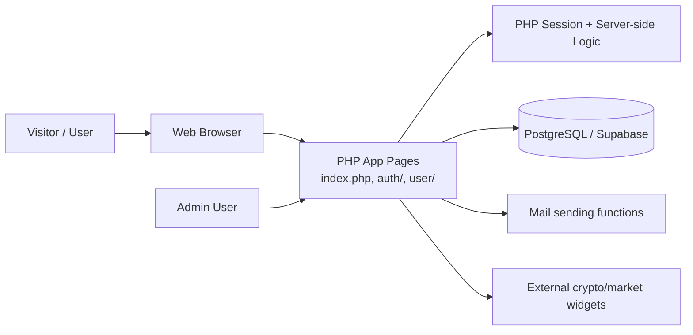

# Ruxfund

Ruxfund is a PHP-based crypto investment / fundraising-style web application. It provides a public marketing site, user registration and authentication, investment plan selection, referral tracking, wallet configuration, transaction summaries, and administrative controls.

This repository is best described as an MVP-style financial web application and a portfolio project. It demonstrates server-side PHP, relational database modeling, and a classic multi-page web app architecture. It is not presented here as a production-ready financial platform.

## Project status

Status: MVP / prototype / functional demo

This repository contains a working application structure and a database schema for a crypto-investment platform, but it still has important limitations:

- There is no verified public deployment URL in the repository.
- No automated test suite is present.
- The project currently relies on a legacy PHP architecture and custom database helpers rather than a modern framework.
- Security hardening should be completed before any real production deployment or public launch.

## Live demo

No verified live application URL was found in the repository or project metadata. Please run the app locally using the instructions below.

## Engineering highlights

- Server-side PHP business logic for auth, account management, deposits, withdrawals, and referral tracking
- PostgreSQL/Supabase schema designed for the app’s data model
- Investment-plan logic driven from database configuration instead of hard-coded values
- Referral-driven account acquisition and incentive model
- Session-based user flow and admin configuration patterns
- Deployment configuration for PHP hosting and Wasmer

## Features

### Implemented

- Public marketing landing page with investment messaging and pricing blocks
- User registration and login
- Referral and affiliate tracking
- Investment plan listing and account funding flow
- Withdrawal and transfer-related transaction handling
- Wallet address management
- KYC submission workflow
- FAQ/testimonial content management
- Admin dashboard and admin login flow
- PostgreSQL/Supabase schema and migration guidance

### Partially implemented or unclear

- Real crypto payment processing and bank/crypto settlement flows are not fully documented or proven in the codebase.
- Some transaction flows are modeled, but direct external blockchain or payment infrastructure integration appears limited to configuration and placeholder logic.
- Some admin and security flows still use older patterns that should be hardened before production use.

### Planned / not represented as complete

- Production-grade financial controls
- Real audit trail and compliance tooling
- Full automated testing pipeline
- Production deployment or monitoring setup

## Technology stack

### Frontend

- HTML
- CSS / SCSS
- JavaScript
- Bootstrap-style UI assets and custom PHP-rendered templates

### Backend

- PHP
- Custom procedural business logic in `includes/functions.php`
- Session-based auth flow

### Database

- PostgreSQL / Supabase
- Legacy MySQL references remain in some documentation and older SQL files

### Deployment / runtime

- PHP built-in server for local use
- Wasmer configuration (`wasmer.toml`)
- Apache-compatible deployment via `.htaccess`

## Architecture

This application is a classic server-rendered PHP web app. Pages are generated directly from PHP templates, and data is loaded from a PostgreSQL database through a custom compatibility layer.



### Key components

- `index.php`: public landing page and marketing content
- `auth/`: signup, login, and authentication flows
- `user/`: authenticated dashboard and account pages
- `includes/server.php`: DB connection bootstrap and session setup
- `includes/functions.php`: business logic and validation helpers
- `supabase_schema.sql`: canonical PostgreSQL schema
- `schema.sql`: legacy MySQL-oriented schema; not for fresh Supabase setup

## Project structure

```text
.
├── README.md
├── .env.example
├── .gitignore
├── .htaccess
├── app.yaml
├── wasmer.toml
├── schema.sql
├── supabase_schema.sql
├── SUPABASE_MIGRATION.md
├── about.php
├── affiliate.php
├── auth/
├── buycoin.php
├── contact.php
├── faq.sql
├── fix.py
├── general.css
├── includes/
├── index.php
├── legal.php
├── privacy.php
├── remote/
├── rux/
├── secured/
├── service.php
├── site-images/
├── terms.php
├── tests/
├── user/
├── Rux09069779701/
├── images/
├── img/
├── _next/
└── __MACOSX/
```

## Prerequisites

To run the project locally, you need:

- PHP 8.1+ recommended, 8.3 compatible with Wasmer config
- A PostgreSQL-compatible database such as Supabase or local PostgreSQL
- Access to a database client or Supabase SQL editor
- A browser for local testing

## Installation

1. Clone the repository:

```bash
git clone https://github.com/sollid-web/ruxfund.git
cd ruxfund
```

2. Copy the environment template:

```bash
cp .env.example .env
```

3. Update `.env` with your database connection values.

4. Create or attach the database and run the PostgreSQL schema:

```bash
# In Supabase SQL Editor or a PostgreSQL client
\i supabase_schema.sql
```

5. Start the PHP web server:

```bash
php -S 127.0.0.1:8000
```

6. Open the site in a browser:

```text
http://127.0.0.1:8000/
```

## Environment configuration

The repository includes `.env.example` and uses environment variables for database access.

Required variables:

- `DB_HOST` — PostgreSQL host or Supabase host
- `DB_PORT` — PostgreSQL port, usually `5432`
- `DB_USERNAME` — database user
- `DB_PASSWORD` — database password
- `DB_NAME` — database name

Example:

```dotenv
DB_HOST=db.YOUR_PROJECT_REF.supabase.co
DB_PORT=5432
DB_USERNAME=postgres
DB_PASSWORD=your_secure_password
DB_NAME=postgres
```

Do not commit production credentials. Keep all secrets in an untracked local `.env` file.

## Running the application

### Local development

```bash
cp .env.example .env
php -S 127.0.0.1:8000
```

### Production-style PHP hosting

The repo includes:

- `wasmer.toml`
- `app.yaml`
- `.htaccess`

These indicate the project was designed for PHP hosting environments and a Wasmer-based deployment flow. The repository does not contain a verified production deployment checklist beyond this basic configuration.

### Database setup

Use `supabase_schema.sql` for a fresh PostgreSQL implementation. Do not run `schema.sql` directly in Supabase because it is MySQL-oriented.

## API and app routes

This project is primarily a server-rendered PHP application rather than a JSON REST API. Pages and flows are implemented as PHP endpoints and routes using direct form submission and server-side logic.

Examples include:

- `/index.php` — public landing page
- `/auth/signup.php` — registration
- `/auth/login.php` — login
- `/user/index.php` — authenticated dashboard
- `/contact.php` — contact form
- `/affiliate.php` — referral or affiliate marketing page

Important: the repository does not provide a formal API specification for JSON endpoints.

## Testing and quality assurance

This repository currently does not include a defined automated test suite, CI workflow, or linting pipeline.

Recommended minimum checks before release:

- PHP syntax validation for all entry points
- Database connection smoke test against the configured PostgreSQL instance
- Manual sign-up/login workflow validation
- Manual deposit/withdrawal workflow validation in a test environment
- Session security smoke test

Example syntax validation:

```bash
php -l index.php
php -l includes/server.php
php -l includes/functions.php
```

## Deployment

The app appears to be designed for PHP server hosting and a Wasmer-style environment, but no verified production deployment record is included in the repository.

Practical deployment notes:

- Ensure `DB_HOST`, `DB_PORT`, `DB_USERNAME`, `DB_PASSWORD`, and `DB_NAME` are configured in the target environment.
- Import the PostgreSQL schema before the first app boot.
- Update the `site` table values such as `site_url`, `email`, `admin`, and contact details.
- Check the app’s server and session configuration after deployment.

## Security considerations

This project contains application logic that is clearly intended for financial operations, so security and session hygiene need to be handled carefully.

Important notes:

- Keep local database credentials in `.env` and never commit them.
- The repository currently contains legacy code patterns and older authentication assumptions that should be reviewed before production use.
- Avoid exposing any sensitive values via public pages or client-facing config.
- Validate and sanitize all user input before processing database operations.
- Use a secure password strategy for admin and user account creation.

## Known limitations

- No verified production deployment or public URL is documented.
- No formal automated tests or CI are configured.
- Some database files and docs mix MySQL and PostgreSQL references.
- Some admin and auth code uses older patterns that should be modernized.
- The project is best treated as a demo or MVP, not a production-ready financial platform.

## Roadmap

### Completed / in place

- User accounts and auth UI
- Referral flow
- Investment plans and wallet features
- PostgreSQL schema and migration guidance
- Local PHP deployment compatibility

### Recommended next steps

1. Audit and harden authentication and authorization flows
2. Standardize on one DB platform and provide a single schema path
3. Add automated tests and CI checks
4. Document local environment setup and deployment more clearly
5. Improve admin security and session handling
6. Add a real release / deployment checklist

## Contributing

Contributions are welcome if the repository is being used as a learning or portfolio project. However, the project does not currently include a formal contribution policy.

For now:

- Open an issue for feature requests or bugs
- Keep changes focused and well-documented
- Do not add secrets or production credentials to the repo
- Prefer small, maintainable changes

## License

No explicit license file was found in the repository root. The project currently does not declare a license. If this project is intended for public distribution or hiring portfolio use, a license decision should be made before release.

## Author and contact

This repository does not provide a clear author, organization, or formal contact section. Use the repository owner information from GitHub when presenting the project. Do not invent additional personal or professional details.

## Quick start

```bash
git clone https://github.com/sollid-web/ruxfund.git
cd ruxfund
cp .env.example .env
# edit .env with your DB values
php -S 127.0.0.1:8000
```

Then import the SQL schema into PostgreSQL/Supabase and open the local app in a browser.

## Summary

Ruxfund is a PHP crypto-investment website prototype with user accounts, plans, referrals, wallet logic, and admin features. It is a credible portfolio project when presented honestly, but it still needs stronger documentation, security review, and operational setup clarity before it can be considered production ready.
