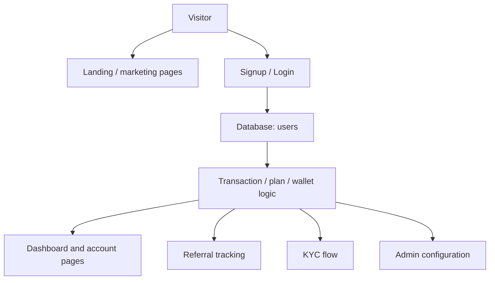

# Architecture

This project is a server-rendered PHP application that combines static marketing pages, authenticated user workflows, and database-driven investment logic.

## Overview

- Public visits are served through PHP pages such as `index.php`, `about.php`, and `contact.php`.
- Authenticated accounts live under `auth/` and `user/`.
- Database access is centralized in `includes/server.php` and `includes/functions.php`.
- User actions (registration, login, deposit, withdrawal, wallet updates, KYC, referrals) are processed with server-side logic rather than a JavaScript API layer.

## Flow

## Main responsibilities

### Frontend shell

The app renders large HTML fragments with embedded PHP variables. The UI uses a custom theme and a set of static assets, including `site-images/`, images, and CSS assets.

### Server-side logic

`includes/functions.php` is the core business logic file. It contains:

- validation helpers
- login and registration logic
- transaction and balance calculations
- referral logic
- email templates
- admin configuration functions

### Database layer

`includes/server.php` creates the database connection using environment variables and a PostgreSQL compatibility wrapper.

## Important design notes

- The app is more of a classic multi-page PHP application than a modern MVC framework application.
- The repository contains both MySQL-oriented and PostgreSQL-oriented artifacts, so the database strategy must be standardized for any formal deployment.
- The application behavior is strongly coupled to database-driven configuration such as `site`, `plan`, and `fak` records.

## Risks and gaps

- No formal API layer or service boundary exists.
- Security review is needed for auth, admin flows, and session assumptions.
- The code is easy to understand at a high level, but not yet structured as a maintainable modern app without a disciplined cleanup effort.
